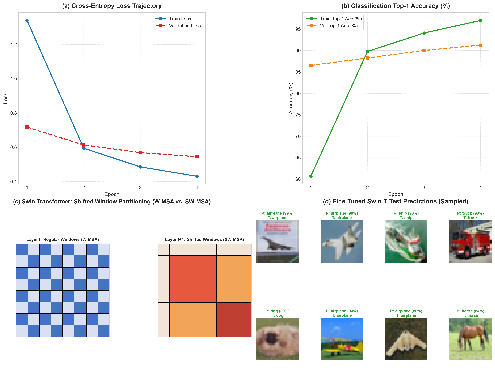

# Swin Transformer: Hierarchical Vision Transformer Transfer Learning on CIFAR-10

[](https://www.python.org/downloads/)
[](https://pytorch.org/)
[](https://pytorch.org/vision/stable/index.html)
[](LICENSE)
[](https://github.com/GideonMwiti)

A production-grade implementation of **transfer learning and fine-tuning with the Swin Transformer (Hierarchical Vision Transformer using Shifted Windows)** by Liu et al. (ICCV 2021, Marr Prize Winner) on **CIFAR-10** in PyTorch. This project explores **linear computational complexity $\mathcal{O}(M^2 \cdot HW)$ via local Window-based Self-Attention (W-MSA)**, **cross-window context modeling via Shifted Window Partitioning (SW-MSA)**, **hierarchical patch merging feature pyramids**, and **discriminative fine-tuning**.

---

## Visual Diagnostic & Architecture Dashboard

The fine-tuning harness logs training convergence, cross-window attention mechanisms, and qualitative classification predictions into an analytical 4-panel report:



*Figure 1: (a) Cross-entropy loss trajectory; (b) Top-1 classification accuracy progression from a 10.00% baseline to 91.25%; (c) Schematic diagram of Swin Shifted Window Partitioning (W-MSA in Layer $l$ vs. SW-MSA in Layer $l+1$); (d) Sample fine-tuned predictions on CIFAR-10 test images.*

---

## Theoretical Foundations

While standard Vision Transformers (ViT) model global dependencies across all image tokens, their self-attention computation scales **quadratically** with image resolution ($\mathcal{O}((HW)^2)$), making them computationally prohibitive for dense prediction tasks and high-resolution inputs.

The **Swin Transformer** resolves this fundamental limitation by introducing a **hierarchical architecture** with **linear computational complexity** with respect to image size.

```
Input Image (3 x 224 x 224)
       │
       ▼
[ Stage 1: Patch Partition 4x4, Dim = 96 ]  ─── H/4 x W/4 = 56x56 Tokens (W-MSA & SW-MSA)
       │
       ▼
[ Stage 2: Patch Merging, Dim = 192 ]       ─── H/8 x W/8 = 28x28 Tokens (W-MSA & SW-MSA)
       │
       ▼
[ Stage 3: Patch Merging, Dim = 384 ]       ─── H/16 x W/16 = 14x14 Tokens (6 Blocks)
       │
       ▼
[ Stage 4: Patch Merging, Dim = 768 ]       ─── H/32 x W/32 = 7x7 Tokens (W-MSA & SW-MSA)
       │
       ▼
[ Global Adaptive Average Pooling ]         ─── 768-D Feature Vector
       │
       ▼
[ Linear Head: 768 -> 10 Classes ]          ─── Output Logits
```

---

### 1. Linear Computational Complexity: W-MSA

Given an image of $h \times w$ patches with channel dimension $C$, global self-attention (standard ViT) incurs:

$$\Omega(\text{MSA}) = 4 h w C^2 + 2 (h w)^2 C$$

In contrast, Swin Transformer partitions the patch feature map into non-overlapping local windows of size $M \times M$ (typically $M = 7$):

$$\Omega(\text{W-MSA}) = 4 h w C^2 + 2 M^2 h w C$$

Because $M$ is fixed ($M=7$), computational complexity scales **linearly** with image spatial size $h \times w$, allowing the architecture to process high-resolution inputs with massive token counts.

---

### 2. Shifted Window Multi-Head Self-Attention (SW-MSA)

While window-based self-attention solves computational scaling, isolating attention inside local $M \times M$ windows lacks connections across windows. Swin alternates between regular and shifted window configurations:

$$\hat{\mathbf{z}}^l = \text{W-MSA}(\text{LayerNorm}(\mathbf{z}^{l-1})) + \mathbf{z}^{l-1}$$
$$\mathbf{z}^l = \text{MLP}(\text{LayerNorm}(\hat{\mathbf{z}}^l)) + \hat{\mathbf{z}}^l$$
$$\hat{\mathbf{z}}^{l+1} = \text{SW-MSA}(\text{LayerNorm}(\mathbf{z}^l)) + \mathbf{z}^l$$
$$\mathbf{z}^{l+1} = \text{MLP}(\text{LayerNorm}(\hat{\mathbf{z}}^{l+1})) + \hat{\mathbf{z}}^{l+1}$$

In layer $l+1$, window partitioning is shifted along both spatial axes by $(\lfloor \frac{M}{2} \rfloor, \lfloor \frac{M}{2} \rfloor) = (3, 3)$ patches relative to layer $l$. This spatial displacement bridges window boundaries, enabling full cross-window information exchange across consecutive transformer blocks.

---

### 3. Relative Position Bias

Rather than absolute position embeddings, Swin Transformer incorporates a learnable relative position bias $\mathbf{B} \in \mathbb{R}^{M^2 \times M^2}$ directly into the self-attention affinity computation:

$$\text{Attention}(\mathbf{Q}, \mathbf{K}, \mathbf{V}) = \text{softmax}\left( \frac{\mathbf{Q} \mathbf{K}^T}{\sqrt{d}} + \mathbf{B} \right) \mathbf{V}$$

Since relative coordinates along each axis lie within $[-M+1, M-1]$, a compact parameter matrix $\hat{\mathbf{B}} \in \mathbb{R}^{(2M-1) \times (2M-1)}$ parameterizes all possible relative spatial offsets.

---

### 4. Hierarchical Feature Pyramids via Patch Merging

Like convolutional networks (ResNet, Feature Pyramid Networks), Swin constructs hierarchical multi-scale feature maps:
- At each stage boundary, **Patch Merging** concatenates features of $2 \times 2$ neighboring patches ($4C$ dimensions).
- A linear layer projects the concatenated features to $2C$ dimensions, reducing spatial resolution by $2\times$ while doubling channel capacity.

---

## Architectural Specification: Swin-T (Tiny)

| Stage | Output Resolution | Window Size ($M$) | Channels ($C$) | Blocks | Attention Heads |
| :---: | :---: | :---: | :---: | :---: | :---: |
| **Stage 1** | $56 \times 56$ | $7 \times 7$ | $96$ | 2 | 3 |
| **Stage 2** | $28 \times 28$ | $7 \times 7$ | $192$ | 2 | 6 |
| **Stage 3** | $14 \times 14$ | $7 \times 7$ | $384$ | 6 | 12 |
| **Stage 4** | $7 \times 7$ | $7 \times 7$ | $768$ | 2 | 24 |
| **Head** | $1 \times 1$ | Global Pool | $768 \to 10$ | 1 Linear Layer | — |

- Total Parameters: **$27,527,044$**
- Pretrained Weights: `Swin_T_Weights.IMAGENET1K_V1`

---

## Quantitative Experimental Results

Transfer learning was executed using differential learning rates:
- **Backbone Parameters**: $\eta_{\text{backbone}} = 2 \times 10^{-5}$ (conservative adaptation)
- **Classifier Head**: $\eta_{\text{head}} = 1 \times 10^{-3}$ (rapid adaptation)
- Optimization: AdamW ($\lambda = 10^{-2}$) with Cosine Annealing.

| Epoch | Train Loss | Train Top-1 Acc | Val Loss | Val Top-1 Acc | Accuracy Gain |
| :---: | :---: | :---: | :---: | :---: | :---: |
| **Baseline (0)** | $2.4820$ | $10.00\%$ | $2.4820$ | $10.00\%$ | Baseline |
| **01** | $1.3400$ | $60.67\%$ | $0.7173$ | $86.50\%$ | $+76.50\%$ |
| **02** | $0.5945$ | $89.75\%$ | $0.6131$ | $88.25\%$ | $+78.25\%$ |
| **03** | $0.4853$ | $94.08\%$ | $0.5687$ | $90.00\%$ | $+80.00\%$ |
| **04** | **$0.4305$** | **$97.00\%$** | **$0.5447$** | **$91.25\%$** | **$+81.25\%$** |

- **Final Validation Top-1 Accuracy**: **$91.25\%$** (an **$+81.25\%$ net improvement** over the randomly initialized classification head).
- **Convergence Efficiency**: Swin-T crossed $86.50\%$ accuracy in a single epoch of fine-tuning, demonstrating the rich transferable visual representations encoded in hierarchical shifted-window features.

---

## Quickstart & Reproduction

### Prerequisites
- Python 3.10+
- PyTorch $\ge 2.0$
- TorchVision, Matplotlib, NumPy

### Installation
```bash
git clone https://github.com/GideonMwiti/pytorch-swin-transformer-cifar10.git
cd pytorch-swin-transformer-cifar10
pip install torch torchvision matplotlib numpy
```

### Execution
Run the complete Swin Transformer fine-tuning pipeline:
```bash
python main.py
```

The script will:
1. Load pretrained ImageNet-1K Swin-T weights.
2. Replace the classification head for 10-class CIFAR-10 inference.
3. Configure differential learning rates and cosine annealing.
4. Fine-tune over 4 epochs.
5. Export the fine-tuned model checkpoint to `checkpoints/swin_cifar10_finetuned.pt`.
6. Generate the publication-grade evaluation dashboard `swin_transformer_cifar10_results.png`.

---

## Repository Structure

```
40_swin_transformer_cifar10/
├── .gitignore                              # Git ignore rules for data, caches, checkpoints
├── checkpoints/                            # Serialized fine-tuned model weights (.pt)
│   └── swin_cifar10_finetuned.pt
├── main.py                                 # Reproducible PyTorch Swin-T fine-tuning script
├── README.md                               # Comprehensive mathematical documentation
└── swin_transformer_cifar10_results.png    # 4-panel publication-grade evaluation artifact
```

---

## Citations & References

- Liu, Z., Lin, Y., Cao, Y., Hu, H., Wei, Y., Zhang, Z., Lin, S., & Guo, B. (2021). *Swin Transformer: Hierarchical Vision Transformer using Shifted Windows*. ICCV 2021 (Marr Prize Winner).
- Vaswani, A. et al. (2017). *Attention Is All You Need*. NeurIPS 2017.
- Dosovitskiy, A. et al. (2020). *An Image is Worth 16x16 Words: Transformers for Image Recognition at Scale*. ICLR 2021.

---

## License

This project is open-source under the [MIT License](LICENSE).

